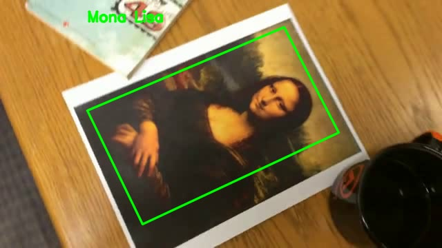
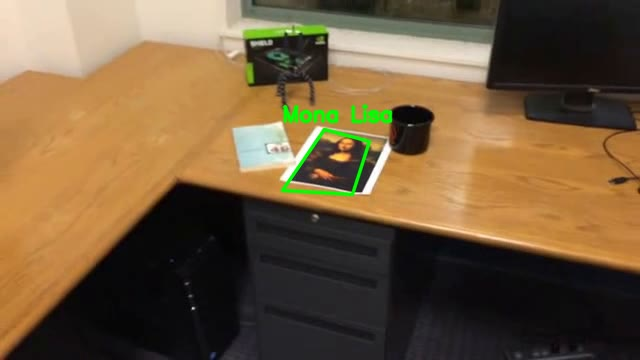
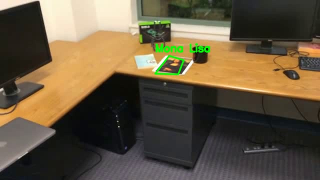
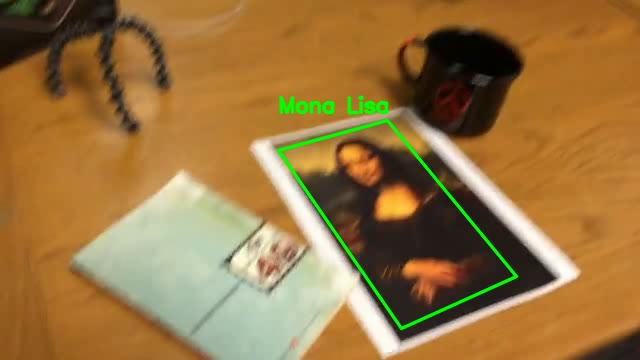
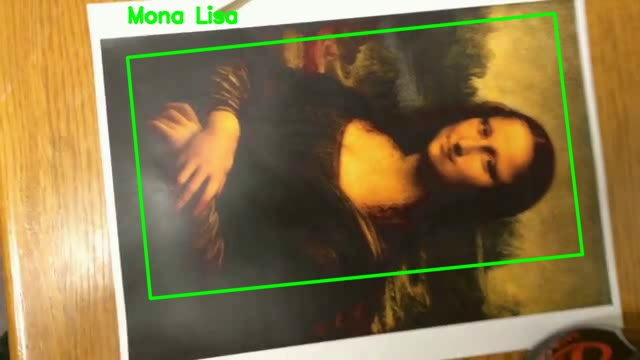
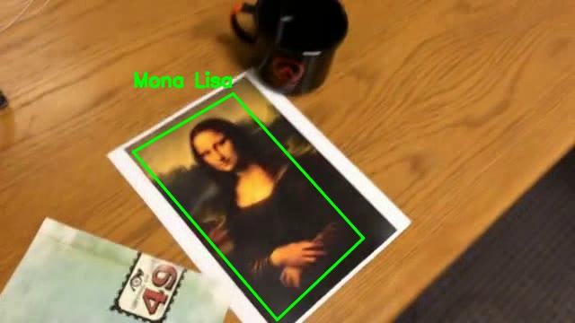

# Лабораторная работа № 2. Трекинг объекта по ключевым точкам

Программа на Python находит на видео плоский текстурный объект, показанный крупным планом в **первом кадре**, и рисует вокруг него зелёную рамку с подписью. Рамка состоит из четырёх сторон и меняет форму при повороте объекта в перспективе. Для работы нужны Python, OpenCV и NumPy; обучение модели и видеокарта не требуются.

## Запуск

Из папки проекта установите зависимости:

```bash
python -m pip install -r requirements.txt
```

Если Windows не находит команду `python`, подставьте полный путь к установленному `python.exe` в команды установки и запуска.

Для обработки трёх тестовых роликов достаточно одной команды:

```bash
python tracker.py
```

Программа возьмёт `mona-lisa.avi`, `mona-lisa-blur.avi` и `mona-lisa-blur-extra-credit.avi` из `test-videos/test-videos/`. Готовые видео появятся в `results/` с суффиксом `_tracked.avi`. `simple_track.avi` — предоставленный образец с готовой разметкой, он не используется как входной ролик.

Для одного произвольного видео:

```bash
python tracker.py path/to/my_video.mp4 --label "Book" --output-dir results
```

По умолчанию эталоном считается весь первый кадр. Если на нём объект занимает только часть кадра, укажите прямоугольник `x y ширина высота` в пикселях:

```bash
python tracker.py path/to/my_video.mp4 --roi 80 40 350 240 --label "Book"
```

Область `--roi` должна включать объект целиком и как можно меньше фона. Подпись нужно задавать латиницей: встроенный шрифт OpenCV не выводит русские буквы. Для собственного опыта снимите плоский предмет с различимыми деталями — например, обложку книги или открытку. Начните запись с крупного неподвижного плана предмета, затем меняйте расстояние и угол съёмки. После съёмки передайте путь к ролику той же команде; сам пользовательский ролик в проекте пока отсутствует.

## 1. Теоретическая база

**Ключевая точка** — характерный участок изображения, который можно снова найти после сдвига, поворота или изменения масштаба. SIFT находит такие участки и описывает каждый дескриптором. Дескрипторы первого кадра сравниваются с дескрипторами очередного кадра. Для каждой точки берутся два ближайших кандидата, и совпадение принимается только тогда, когда лучший заметно ближе второго. Это тест отношения расстояний Лоу.

У плоского объекта найденные совпадения позволяют оценить **гомографию** — преобразование координат между эталоном и текущим кадром. RANSAC отбрасывает случайные совпадения, не согласующиеся с общим преобразованием. Четыре угла эталона после применения гомографии образуют рамку, которая учитывает перспективу.

Когда объект становится маленьким, повторный поиск SIFT может не дать достаточно совпадений. Поэтому между поисками программа сопровождает характерные точки **оптическим потоком Лукаса–Канаде**. Точки прослеживаются из прошлого кадра в текущий и обратно: если обратный путь сильно отличается, такая точка отбрасывается. По оставшимся точкам оценивается движение рамки. Периодический поиск SIFT заново привязывает рамку к изображению объекта и уменьшает накопленную ошибку.

## 2. Описание системы

Вся логика находится в `tracker.py`. Первый кадр или указанная область `--roi` служит эталоном. Алгоритм обрабатывает кадры последовательно:

1. На первом кадре SIFT строит эталонные дескрипторы, а `goodFeaturesToTrack` выбирает точки для сопровождения внутри объекта.
2. На очередном кадре оптический поток переносит точки. RANSAC вычисляет преобразование между соседними кадрами и переносит четыре угла рамки.
3. Каждые пять кадров, а также при потере потока, SIFT пытается найти объект заново по эталону. Достаточное число согласованных совпадений даёт новую рамку.
4. Невыпуклая, чрезмерно маленькая или уходящая далеко за кадр рамка отвергается. Когда надёжной оценки нет, рамка не рисуется, чтобы не показывать заведомо неверное положение.
5. Каждый кадр записывается в выходной AVI, а после обработки выводятся число кадров с рамкой и общее число кадров.

В коде `PlanarTracker` отвечает за поиск и сопровождение, `process_video` — за чтение и запись ролика, `main` — за параметры командной строки. Код не зависит от имени файла: на видео с другим объектом достаточно задать его путь и при необходимости `--roi`.

### Основные фрагменты кода

**Подготовка эталона.** Из первого кадра берётся весь объект или область `--roi`. SIFT один раз вычисляет точки и дескрипторы, с которыми потом сравниваются кадры видео:

```python
self.template = gray[y:y + h, x:x + w]
self.corners = np.float32([[x, y], [x + w - 1, y],
                           [x + w - 1, y + h - 1], [x, y + h - 1]])
self.sift = cv2.SIFT_create(nfeatures=3000, contrastThreshold=0.015)
self.ref_keys, self.ref_desc = self.sift.detectAndCompute(self.template, None)
```

**Повторный поиск объекта.** Два ближайших совпадения проходят тест Лоу; затем одно и то же место кадра не допускается в несколько пар. RANSAC оставляет согласованные пары, а гомография переносит углы эталона на текущий кадр:

```python
pairs = self.matcher.knnMatch(self.ref_desc, desc, k=2)
good = sorted((a for pair in pairs if len(pair) == 2
               for a, b in [pair] if a.distance < 0.75 * b.distance),
              key=lambda match: match.distance)
unique, used = [], set()
for match in good:
    if match.trainIdx not in used:
        unique.append(match)
        used.add(match.trainIdx)
source = np.float32([self.ref_keys[m.queryIdx].pt for m in unique]).reshape(-1, 1, 2)
target = np.float32([keys[m.trainIdx].pt for m in unique]).reshape(-1, 1, 2)
matrix, inliers = cv2.findHomography(source, target, cv2.RANSAC, 4.0)
local_corners = self.corners - self.corners[0]
polygon = cv2.perspectiveTransform(local_corners.reshape(-1, 1, 2), matrix).reshape(-1, 2)
```

Здесь показаны основные строки метода `_detect`; проверки числа совпадений, инлаеров и формы рамки находятся в полном коде.

**Сопровождение между поисками.** Оптический поток переносит точки вперёд и обратно. Точки с большой ошибкой обратного хода исключаются, после чего находится движение рамки между соседними кадрами:

```python
moved, forward, _ = cv2.calcOpticalFlowPyrLK(self.previous, gray, self.points, None, **options)
back, backward, _ = cv2.calcOpticalFlowPyrLK(gray, self.previous, moved, None, **options)
keep = ((forward.ravel() == 1) & (backward.ravel() == 1)
        & (np.linalg.norm(back - self.points, axis=2).ravel() < 1.5))
old, new = self.points[keep], moved[keep]
matrix, inliers = cv2.findHomography(old, new, cv2.RANSAC, 3.0)
polygon = cv2.perspectiveTransform(self.polygon.reshape(-1, 1, 2), matrix).reshape(-1, 2)
```

Это ключевые строки метода `_flow`; проверки на отсутствие точек и на неудачную гомографию для краткости опущены.

**Выбор результата.** Обычно используется оптический поток. Каждые пять кадров или после его потери запускается поиск SIFT; при успешном поиске он обновляет рамку и точки для следующего кадра:

```python
flow_polygon, flow_points = self._flow(gray)
detected = self._detect(gray) if self.frame_number % 5 == 0 or flow_polygon is None else None
if detected is not None:
    self.polygon = detected
    self.points = self._new_points(gray, detected)
elif flow_polygon is not None:
    self.polygon = flow_polygon
    self.points = flow_points
else:
    self.polygon = None
    self.points = None
```

В полном методе `update` точки также периодически пополняются. Если рамка найдена, `process_video` рисует её через `cv2.polylines`, добавляет подпись через `cv2.putText` и записывает кадр в выходной файл.

## 3. Результаты и тестирование

Проверены все три входных варианта из `test-videos/test-videos/`. Каждый содержит 558 кадров размером 640×360. На контрольных кадрах рамка располагается вдоль изображения картины и поворачивается вместе с ним.

| Видео | Кадров с рамкой | Доля | Результат |
| --- | ---: | ---: | --- |
| `mona-lisa.avi` | 558 / 558 | 100,0 % | [Открыть](results/mona-lisa_tracked.avi) |
| `mona-lisa-blur.avi` | 539 / 558 | 96,6 % | [Открыть](results/mona-lisa-blur_tracked.avi) |
| `mona-lisa-blur-extra-credit.avi` | 530 / 558 | 95,0 % | [Открыть](results/mona-lisa-blur-extra-credit_tracked.avi) |

Контрольные кадры показывают работу при изменении масштаба и ракурса. Все изображения взяты из сохранённых видео с результатом:

| Крупный план, `mona-lisa` | Дальний план, `mona-lisa` |
| --- | --- |
|  |  |

| Дальний план, `mona-lisa-blur` | Поворот, `mona-lisa-blur` |
| --- | --- |
|  |  |

| После раннего размытия, `extra-credit` | Поздний кадр, `extra-credit` |
| --- | --- |
|  |  |

Пропуски на двух усложнённых роликах связаны прежде всего с участками сильного размытия: детали картины там почти не различимы, поэтому сопоставление точек и оптический поток становятся ненадёжными. После появления чётких деталей объект находится снова. Эти доли показывают **наличие рамки**, а не численную точность её углов: ручная покадровая разметка для расчёта ошибки не выполнялась.

Собственного снятого видео среди предоставленных файлов нет, поэтому результат для него не заявляется. После съёмки его можно обработать командой из раздела «Запуск» и дополнить таблицу результатом.

## 4. Выводы

Ключевые точки позволяют узнавать текстурную картину при изменении масштаба и ракурса, а гомография даёт перспективную рамку вместо обычного прямоугольника по осям кадра. Оптический поток помогает удерживать рамку, когда объект становится мелким. Главный предел простого алгоритма — сильное размытие, перекрытие или отсутствие различимых деталей: в таких условиях программа предпочитает пропустить рамку, а затем повторно найти объект.

## 5. Использованные источники

- Условие лабораторной работы № 2 из предоставленного PDF.
- [OpenCV: Feature Matching + Homography to find Objects](https://docs.opencv.org/4.x/d1/de0/tutorial_py_feature_homography.html) — SIFT, сопоставление, RANSAC и проекция углов.
- [OpenCV: Optical Flow](https://docs.opencv.org/4.x/d4/dee/tutorial_optical_flow.html) — сопровождение точек методом Лукаса–Канаде.
- [Пример DeminGit](https://github.com/DeminGit/SKOI/tree/main/lab2) и [пример mike-yasnov](https://github.com/mike-yasnov/scai-lab-2) — ориентиры по структуре решения и содержанию отчёта.
